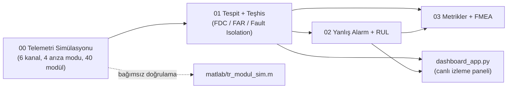
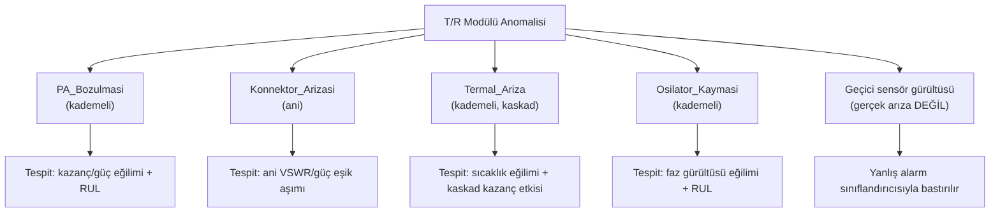

# radar-tr-modul-phm

AESA radar dizisindeki T/R (verici-alıcı) modülleri için sentetik BIT (Built-In Test) telemetrisi üzerinde **arıza tespiti, teşhis/lokalizasyon, yanlış alarm ayrıştırma ve kestirimci bakım (RUL)**: uçtan uca bir PHM (Prognostics and Health Management) çalışması.

Simülasyon → tespit → teşhis → yanlış alarm → kalan ömür → canlı izleme paneli zinciri tek bir sistem olarak kuruldu. Her katmanın çıktısı bir sonrakinin girdisi.

## Veri hakkında

Telemetri **sentetiktir**. Eşikler, rampa süreleri, gürültü seviyeleri ve FMEA içeriği gerçek bir ürün spesifikasyonundan değil, T/R modülü arıza literatüründeki genel davranış biçimlerinden (güç amplifikatörü bozulması, VSWR/konnektör arızası, termal kayma, LO faz gürültüsü) türetildi. Gizli veya tescilli hiçbir veri içermez. Bunun karşılığında pipeline dış veriye ihtiyaç duymadan uçtan uca çalışır ve aşağıdaki metrikleri üretir.

## Neyi gösteriyor

| Konu | Nerede |
|---|---|
| Arıza senaryosu modelleme ve simülasyon | [`00_tr_modul_simulasyonu.py`](00_tr_modul_simulasyonu.py): 6 kanal, 40 modül, 4 arıza modu + geçici anomaliler |
| Bağımsız doğrulama (MATLAB) | [`matlab/tr_modul_sim.m`](matlab/tr_modul_sim.m): simülasyonun küçültülmüş MATLAB tekrarı |
| Arıza tespit algoritmaları ve yöntem seçimi | [`01_ariza_tespit_teshis.py`](01_ariza_tespit_teshis.py): kural tabanlı / IsolationForest / RandomForest karşılaştırması |
| Teşhis / arıza lokalizasyonu (test edilebilirlik) | `01_...` teşhis sınıflandırıcısı, Fault Isolation Accuracy |
| Yanlış alarm ayrıştırma ve kestirimci bakım | [`02_yanlis_alarm_kestirimci_bakim.py`](02_yanlis_alarm_kestirimci_bakim.py): olay tabanlı sınıflandırıcı + RUL |
| Emniyet analizi | [`03_metrikler_ve_fmea.py`](03_metrikler_ve_fmea.py) → [`sonuclar/fmea_tablosu.md`](sonuclar/fmea_tablosu.md) |
| Operatör ekranı | [`dashboard_app.py`](dashboard_app.py) (Streamlit) |

Terimler (BIT, FDC, FAR, MTTD, RUL, FMEA…) için: [`04_kavramlar.md`](04_kavramlar.md).

## Mimari



### Arıza modları



## Çalıştırma

GPU gerekmez, CPU'da saniyeler içinde biter. Script'ler aynı tohum değeriyle (`SEED`) çalıştığı için sonuçlar tekrarlanabilir. Veri ve model dosyaları depoda tutulmuyor, `00` ve `01` çalıştırılınca yeniden üretiliyor.

```bash
pip install -r requirements.txt
python 00_tr_modul_simulasyonu.py
python 01_ariza_tespit_teshis.py
python 02_yanlis_alarm_kestirimci_bakim.py
python 03_metrikler_ve_fmea.py
python -m pytest test_dashboard_mantigi.py
streamlit run dashboard_app.py
```

Dosyalar `# %%` hücrelerine bölündü, VSCode/Jupyter'da hücre hücre de çalıştırılabilir.

## Tasarım kararları

- **Modül bazlı, arıza moduna göre katmanlı train/test ayrımı.** Satır bazlı rastgele ayrım değil: bir modülün tüm zaman serisi ya eğitimde ya testte (grup sızıntısını önlemek için). Arıza başına yalnızca 5 modül olduğundan, rastgele bir ayrım bazı arıza türlerini testten tamamen dışarıda bırakabilirdi; bu yüzden katmanlama eklendi.
- **Üç tespit yöntemi bilerek karşılaştırıldı.** Denetimli RF en iyi FDC/FAR'ı veriyor ama etiketli arıza geçmişi gerektiriyor. IsolationForest etiketsiz çalışıyor ama yanlış alarm oranı 6 kat daha yüksek. Gerçek bir sistemde muhtemelen ikisi birlikte kullanılır: IsolationForest yeni/bilinmeyen arıza türleri için güvenlik ağı, RF bilinen türler için ana tespit.
- **Nominal eşikler yalnızca sağlıklı eğitim örneklerinden türetildi.** Arıza verisi kalibrasyona karışmıyor; gerçek bir BIT kalibrasyonu da böyle yapılır.
- **RUL için doğrusal eğilim ekstrapolasyonu.** Gerçek arıza-ömür verisi olmadan daha karmaşık bir model aşırı uyum riski taşır; önce basit ve yorumlanabilir bir yaklaşımla ölçmek tercih edildi.
- **Ani arıza (Konnektor_Arizasi) için RUL hesaplanmıyor.** Ani arızanın kademeli bir ön belirtisi yok; RUL kavramının burada anlamı olmadığı açıkça belgelendi.

## Sonuçlar

Tüm sayılar `sonuclar/` klasöründeki çıktılardan.

### Arıza tespiti (test: 12 modül / 4800 örnek)

| Yöntem | Fault Detection Coverage | False Alarm Rate | Geçici Sıçrama Yakalama | MTTD (örnek) |
|---|---|---|---|---|
| Kural tabanlı (\|z\|>3) | 91.5% | 1.2% | 81.8% | 14.2 |
| IsolationForest (denetimsiz) | 86.3% | 7.6% | 36.4% | 7.3 |
| **RandomForest (denetimli)** | **93.3%** | **0.9%** | **90.9%** | 12.3 |

### Teşhis / lokalizasyon

**Fault Isolation Accuracy: 96.8%** (1384 test örneği, 4 sınıf, 44 hata). Konnektör arızası hatasız ayrıldı (429/429). Hataların tamamı üç kademeli arıza arasında: Osilatör → Termal 12, PA → Osilatör 12, PA → Termal 9, Termal → Osilatör 11. Bu üçü de yavaş başlayan arızalar olduğu için erken evrede birbirine benzemeleri beklenen bir durum. Ani başlayan konnektör arızası ise ilk örnekten itibaren ayırt edilebiliyor.

### Yanlış alarm sınıflandırıcısı

| Metrik | Değer |
|---|---|
| F1 (gerçek arıza) | 54.5% |
| F1 (yanlış alarm) | 87.5% |
| Yanlış alarm bastırma oranı | 100% |

Sınıflandırıcı asimetrik çalışıyor: Geçici sıçramaların hepsini doğru bastırıyor, ama bunun bedeli bazı gerçek arızaların da "yanlış alarm" sanılması. Sınıf dengesizliği de buna katkıda bulunuyor: 51 test olayının yalnızca 16'sı gerçek arıza. Gerçek bir sistemde bu, maliyet asimetrisine göre ayarlanacak bir karar eşiği meselesi: Kaçırılan bir arıza ile gereksiz bir bakım çağrısının maliyeti farklıdır. Panel `predict_proba` çıktısını zaten gösteriyor, sabit 0.5 eşiği yerine operasyonel maliyete göre kaydırılabilir.

### Kestirimci bakım (RUL)

Kademeli arızalı 4 test modülünde **ortalama mutlak hata 4.7 örnek**. Rampa uzunlukları 120–180 örnek, yani tipik hata rampanın %3–4'ü kadar.

## Canlı izleme paneli

`streamlit run dashboard_app.py`: Modül seçimi ve zaman ekseninde gezinme ile o ana kadarki telemetri, tespit, teşhis, yanlış alarm olasılığı ve RUL tek ekranda gösterilir. Panelin kullandığı hesaplama mantığı (`01`/`02`'deki aynı modeller ve özellikler) arayüzden bağımsız olarak [`test_dashboard_mantigi.py`](test_dashboard_mantigi.py) ile test ediliyor. Test dört senaryoyu kapsıyor: sağlıklı, PA_Bozulmasi, Konnektor_Arizasi ve Osilator_Kaymasi. Örneğin ani arızada RUL'un `None`, kademeli arızalarda dolu olması gerektiği kontrol ediliyor.

## Sınırlamalar

- Telemetri sentetik. Gerçek bir T/R modülünün gürültü ve korelasyon yapısı muhtemelen burada modellenenden daha karmaşık.
- FMEA, gerçek bir üretici dokümanından değil, genel T/R modülü arıza literatüründen esinlenerek hazırlandı.
- Yanlış alarm sınıflandırıcısı küçük bir olay setinde (51 test olayı) değerlendirildi, F1 değerleri bu ölçekte gürültülü olabilir.
- MATLAB tarafı düz bir script. Simulink modeli yok.

## Geliştirme fikirleri

- IsolationForest ve RandomForest'ı iki katmanlı bir tespit hattında birleştirmek: önce denetimsiz genel tarama, sonra denetimli teyit.
- Karar eşiğini (0.5) maliyet ağırlıklı ROC/precision-recall analiziyle optimize etmek.
- Açık kaynak bir T/R modülü veri sayfasından daha gerçekçi gürültü/korelasyon parametreleri türetmek.
- `matlab/tr_modul_sim.m`'i Simulink'e taşımak.

Author: [Beyza Nur Kılıç](https://github.com/l4NGEL)
